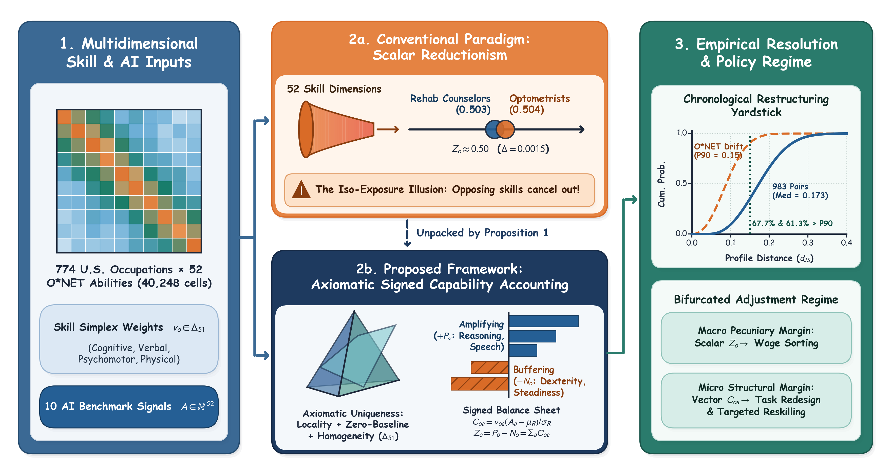
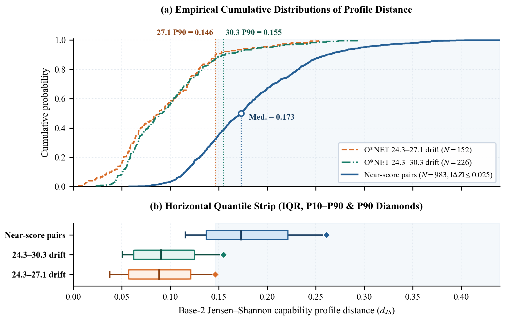
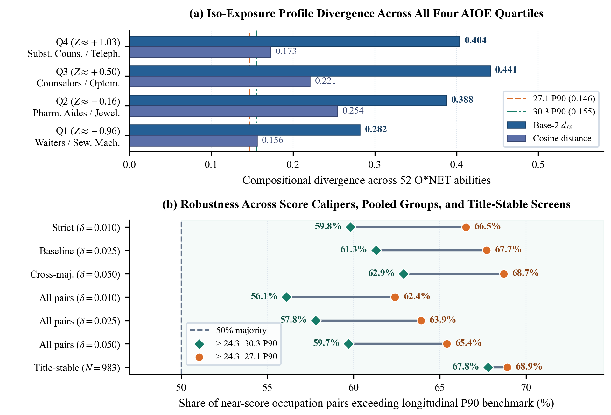
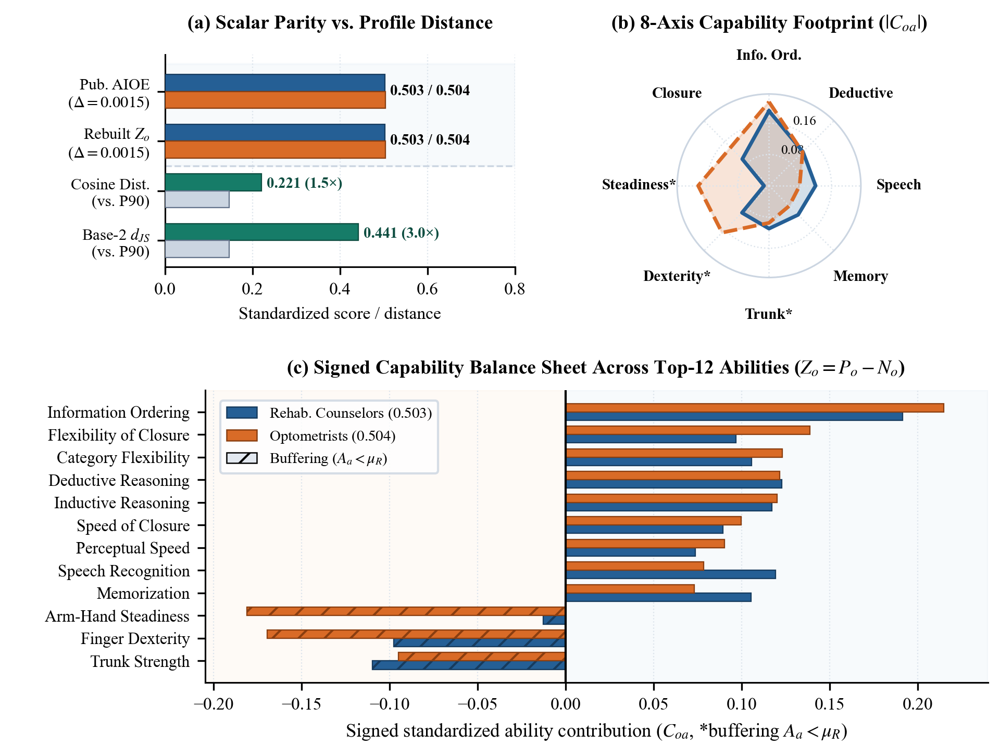
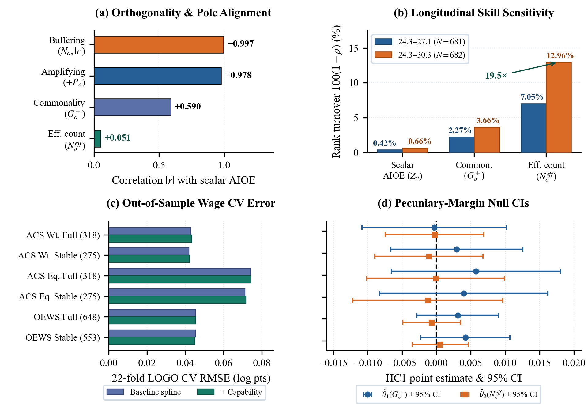

# Occupational-AI-Exposure-Ability-Accounting

**Beyond Scalar Exposure: Axiomatic Signed Capability Accounting and the Iso-Exposure Illusion in U.S. Occupations | 超越标量暴露度：职业人工智能暴露度的公理化有符号能力核算与等暴露度幻觉**

[](#quick-start--快速开始)
[](#quick-start--快速开始)
[](#repository-layout--目录结构)

> **[English](#english-overview) | [中文说明](#中文说明)**  
> This repository shares core analytical utilities, SHA-256 provenance-verified summary tables, publication-ready frameless visual benchmarks (including editable SVG and PowerPoint architecture slides), and a zero-dependency interactive explorer accompanying our study. Feedback, issues, and academic discussions are warmly welcomed.  
> 本仓库开源分享《超越标量暴露度：职业人工智能暴露度的公理化有符号能力核算》研究的核心核算工具、经 SHA-256 校验的基准汇总表、无外框论文实验图表（附带可编辑 SVG 与 PPTX 总体架构图）及零外部依赖的本地交互式可视化探索器，欢迎学术交流、指正与复用。

<p align="center">
  
</p>

---

## English Overview

### 1. Motivation & Core Method

Composite indices of occupational artificial intelligence (AI) exposure compress multidimensional job skill requirements onto a single one-dimensional scale. Because linear aggregation is compensatory across dimensions, occupations with virtually identical headline scores can confront contrasting technological pressures—a phenomenon we refer to as the **iso-exposure illusion**.

Holding the benchmark Felten–Raj–Seamans (AIOE) capability mapping fixed across **774 six-digit U.S. occupations** and **52 O\*NET abilities** ($40{,}248$ cells), this repository implements **Axiomatic Signed Capability Accounting**:

1. **Signed Capability Balance Sheet ($Z_o = P_o - N_o = \sum_{a=1}^{52} C_{oa}$)**  
   Under locality (ability separability), zero-baseline consistency, and degree-one homogeneity over the unit skill simplex $\Delta_{51}$, the unique local additive allocation rule $C_{oa} = v_{oa}(A_a - \mu_R)/\sigma_R$ partitions standardized exposure into:
   - **Exposure-Amplifying Capabilities ($+P_o,\; A_a > \mu_R$)**: Cognitive, analytical, and spoken/written language capabilities that raise net occupational exposure;
   - **Exposure-Buffering Capabilities ($-N_o,\; A_a < \mu_R$)**: Psychomotor, manual-dexterity, and physical bottlenecks that pull net exposure downward;
   - **Orthogonal Structural Dispersion ($N_o^{eff}$)**: Effective positive-ability count ($r = +0.0512$ with scalar AIOE, capturing **99.7% orthogonal structural variation**).

2. **Chronological Occupational Restructuring Yardstick**  
   Across **983 cross-major occupation pairs** within $0.025$ standard deviations on both published and reconstructed AIOE scores, the median base-2 Jensen–Shannon profile distance is **0.1731** ($P_{90} = 0.2612$). Calibrated against historical within-occupation skill updates across O\*NET releases 24.3–27.1 ($N = 152$) and 24.3–30.3 ($N = 226$), **67.7%** and **61.3%** of iso-exposure pairs (and **68.9%** / **67.8%** under title-stable screens) diverge more than the 90th percentile of multi-year skill revisions.

<p align="center">
  
  &nbsp;&nbsp;
  
</p>

3. **Case-Level Mechanism & Bifurcated Adjustment Regime**  
   Comparing *Rehabilitation Counselors* ($0.503$) and *Optometrists* ($0.504$) across an 8-axis polar capability radar and 12-ability signed balance sheet illustrates how verbal-counseling exposure and precision manual buffering offset to produce scalar parity ($\Delta = 0.0015$, $d_{JS} = 0.4414$). Pairing 22-fold leave-one-major-group-out cross-validated wage regressions and HC1 95%-CI forest plots (ACS & OEWS) with longitudinal rank-turnover tests demonstrates that scalar exposure tracks between-occupation wage sorting, whereas multidimensional capability profiles capture within-occupation task reorganization ($16.6\times$–$19.5\times$ higher longitudinal rank sensitivity).

<p align="center">
  
  &nbsp;&nbsp;
  
</p>

---

### Quick Start / 快速开始

Requires **Python 3.10+**. The core verification suite and interactive HTML explorer run out of the box using **only the Python standard library** (zero third-party packages, zero GPU requirement, `< 1s` runtime):

```bash
# 1. Run automated unit tests (SHA-256 provenance, axiomatic add-up identity, and JSD metric bounds)
python -m unittest discover -s tests -v

# 2. Verify all retained benchmark CSV tables and emit analysis/reproduced/verification_report.json
python analysis/analyze_retained_bundle.py

# 3. Build and open the local interactive HTML Capability Balance Sheet Explorer
python demo.py
```

*(On headless servers, run `python demo.py --no-open` and open `demo_output/index.html` in a browser. For full scientific modules using `numpy`, `pandas`, `scipy`, `statsmodels`, and `matplotlib`, install `pip install -r requirements.txt`.)*

---

### Citation / 引用格式

If you find this framework, verification suite, or benchmark dataset useful in your research, please consider citing our work:

```bibtex
@article{wu2026beyondscalar,
  author  = {Wu, Yonghao and Huang, Ruoke and Wu, Zuxin and Wang, Ruirong and Liu, Chang and Filaretov, Vladimir and Yukhimets, Dmitry},
  title   = {Beyond Scalar Exposure: Axiomatic Signed Capability Accounting and the Iso-Exposure Illusion in U.S. Occupations},
  year    = {2026},
  note    = {Open-source replication package: https://github.com/WYH302/Occupational-AI-Exposure-Ability-Accounting}
}
```

---

### Repository Layout / 目录结构

| Path / 路径 | Description / 功能说明 | Dependencies / 依赖要求 |
| :--- | :--- | :--- |
| `demo.py` | Interactive local HTML dashboard for capability distributions, quartile pairs, caliper checks, and wage models / 本地交互式 HTML 可视化面板 | Python 3.10+ stdlib only |
| `analysis/analyze_retained_bundle.py` | Offline SHA-256 provenance verifier and signed balance-sheet calculator / 离线 SHA-256 数据校验与有符号能力核算器 | Python 3.10+ stdlib only |
| `analysis/two_layer_accounting.py` | Full-precision 52-ability decomposition, base-2 $d_{JS}$, commonality $G_o^+$, and effective dispersion $N_o^{eff}$ / 全精度 52 维分解与散度指标计算 | `numpy`, `pandas` |
| `analysis/revision_statistics.py` | CPI-U deflation, O\*NET ability alias harmonization, HC1 Wald tests, and FDR routines / 物价平减、能力对齐与稳健统计检验 | `numpy`, `pandas`, `statsmodels` |
| `analysis/revision_experiments.py` | Longitudinal O\*NET 24.3/27.1/30.3 benchmarks and 22-fold LOGO cross-validated wage models / 跨期演进标尺与分组交叉验证回归流程 | Public O\*NET, BLS OEWS & IPUMS ACS |
| `data/retained_tables/` | `PROVENANCE.csv` + 8 SHA-256 verified summary benchmark CSVs + caliper display table / 经哈希校验的基准结果汇总表 | Included in repo |
| `assets/` | Framework diagram (`.png`, editable `.svg`, 1:1 `.pptx`) and frameless empirical diagnostic figures / 总体架构图（含可编辑 SVG/PPTX）与无外框核心实验图表 | Included in repo |
| `tests/test_retained_bundle.py` | Automated unit test suite / 自动化单元测试套件 | Python 3.10+ stdlib only |

---

## 中文说明

### 1. 研究背景与方法简介

现有的职业人工智能（AI）暴露度综合指数通常将数十个维度的职业技能需求线性加总为一个单一标量分数。由于线性加总天然具有**跨维度可补偿性（Compensability）**，处于同一总分等高线上的不同职业，往往在底层技能空间中面临截然不同的技术冲击——我们将这一统计遮蔽现象称为**“等暴露度幻觉（The Iso-Exposure Illusion）”**。

本项目固定经典的 Felten–Raj–Seamans（AIOE）基准映射，覆盖美国 **774 个六位码标准职业（SOC）** 与 **52 项 O\*NET 人类能力维度**（共 $40{,}248$ 个职业-能力单元），实现了**公理化有符号能力核算框架（Axiomatic Signed Capability Accounting）**：

- **有符号能力资产负债表（$Z_o = P_o - N_o = \sum_{a=1}^{52} C_{oa}$）**：在局部可分性、零基线一致性与一次齐次性三条公理下，单位单纯形 $\Delta_{51}$ 上存在唯一的局部加性分配规则 $C_{oa} = v_{oa}(A_a - \mu_R)/\sigma_R$，将职业总暴露度精确拆解为**暴露放大能力（$+P_o$，如推理与语言理解）**与**暴露缓冲瓶颈（$-N_o$，如精细手指灵巧度与手臂稳定性）**，机器精度加总误差仅 $1.55 \times 10^{-15}$；同时提取出与标量总分 **99.7% 正交**的有效能力分散度指标 $N_o^{eff}$（$r = +0.0512$）。
- **跨期职业技能演进标尺（Chronological Restructuring Yardstick）**：在总分相差不超过 $0.025$ 个标准差的 **983 对跨大类同暴露职业对**中，以 2 为底的 Jensen–Shannon 轮廓距离中位数达 **0.1731**（约为同一职业多年期技能自然演进中位数的 **1.96 倍**）；其中 **67.7%** 与 **61.3%** 的职业对（在职位名称完全不变的稳健样本中升至 **68.9%** 与 **67.8%**）超过了 O\*NET 24.3–27.1 与 24.3–30.3 跨期演进分布的第 90 百分位阈值。
- **二元调整机制（Bifurcated Adjustment Regime）**：结合 22 折“留一职业大类法（LOGO）”交叉验证薪资回归（ACS 与 OEWS 面板）及跨期秩敏感性检验发现：标量总分主要刻画**职业间宏观薪资排序（Pecuniary Margin）**，而 52 维能力资产负债表则捕捉**职业内微观工作流重塑与精准再培训需求（Structural Margin，跨期秩变动敏感度为标量分数的 16.6–19.5 倍）**。

### 2. 数据合规与隐私说明

- **仓库自带数据（`data/retained_tables/`）**：包含全部经 SHA-256 哈希锁定的聚合级职业基准结果表，不含任何个人微观隐私记录或机构内部敏感信息。
- **外部公开数据源**：原始 O\*NET 数据库（24.3 / 27.1 / 30.3）、AIOE 基准关联矩阵、美国人口普查局职业交叉表及劳工统计局 OEWS / CPI-U 数据均可从官方渠道公开获取；美国社区调查（ACS）个体微观数据需遵循 IPUMS USA（`https://usa.ipums.org`）标准学术使用条款自行提取，本仓库严格遵守数据许可协议不二次分发原始个体记录。
- **使用与反馈**：本代码库旨在以轻量、透明、可复现的方式服务于劳动经济学与计算社会科学社区。如发现任何疏漏或有改进建议，欢迎通过 GitHub Issues 交流指正。

---

## Research Notes: Design Choices, Pitfalls & Key Observations / 研究手记：真实思考、踩过的坑与独特观察

1. **Why random 5-fold CV fails on occupational panels（为什么随机 5 折交叉验证在职业数据上会“虚高”）**  
   Early experiments using naive random 5-fold cross-validation produced artificially optimistic out-of-sample RMSE because closely related six-digit SOC specialties within the same two-digit occupational family leaked across training and test splits. Switching to **22-fold leave-one-major-group-out (LOGO) cross-validation** with strictly fold-internal spline fitting eliminated taxonomic leakage cleanly.  
   早期直接对 6 位 SOC 职业做随机 5 折交叉验证时，同属一个 2 位大类的高度相似细分职业被同时拆进训练集与测试集，导致样本外误差虚低。改为严格折内拟合样条基函数的 **22 折留一职业大类（LOGO）交叉验证**后，分类学泄露被彻底消除。

2. **Taxonomy drift pitfall across O\*NET releases（O\*NET 跨版本能力重命名陷阱）**  
   While benchmarking O\*NET 24.3 against 27.1 and 30.3, we discovered a silent label rename (`"Visual Color Discrimination"` → `"Visual Color Determination"`) that would silently drop an ability column if merged naively by exact string match. Our alias-harmonization routine in `analysis/revision_statistics.py` guards against this exact pitfall.  
   在对接 O\*NET 24.3 与 27.1/30.3 跨期演进数据时，我们踩过一个隐蔽的坑：官方将能力名 `"Visual Color Discrimination"` 悄然改成了 `"Visual Color Determination"`，直接按名称合并会悄悄丢掉 1 维数据。我们已在 `analysis/revision_statistics.py` 中显式固化别名对齐校验。

3. **Why boundary-zero-safe base-2 Jensen–Shannon beats raw KL / log-ratio metrics（为何选择零值安全的 base-2 JS 距离）**  
   Many cognitive occupations carry near-zero manual/psychomotor contribution weights. Raw Kullback–Leibler or log-ratio compositional distances either diverge to infinity or become sensitive to arbitrary pseudocount smoothing constants; base-2 $d_{JS} \in [0,1]$ handles structural boundary zeros analytically with zero tuning constants.  
   大量脑力职业在体力/精细动作维度上权重接近于零，直接用 KL 散度或对数比值（CLR/ILR）会触发零值发散或受人为平滑常数影响；base-2 Jensen–Shannon 距离在 $[0,1]$ 有界且天然免平滑常数。

4. **Reframing the short-run wage null as an insight rather than a dead end（把短期薪资无显著增量转化为“二元调整机制”洞察）**  
   Rather than p-hacking spline knots to chase a spurious wage correlation, evaluating ACS/OEWS wage regressions alongside longitudinal O\*NET rank turnover revealed the deeper truth: scalar exposure governs macro between-occupation pecuniary sorting, whereas capability balance sheets govern micro within-occupation task reorganization (`16.6×–19.5×` rank sensitivity).  
   面对短期薪资回归中静态能力指标 $\Delta R^2 \le 0.0037$ 的现实，我们没有通过调参“刷显著性”，而是结合跨期秩变动检验，反而发现了更本质的**二元调整机制**：标量分数刻画宏观薪酬排序，而能力账本捕捉微观任务重组。
